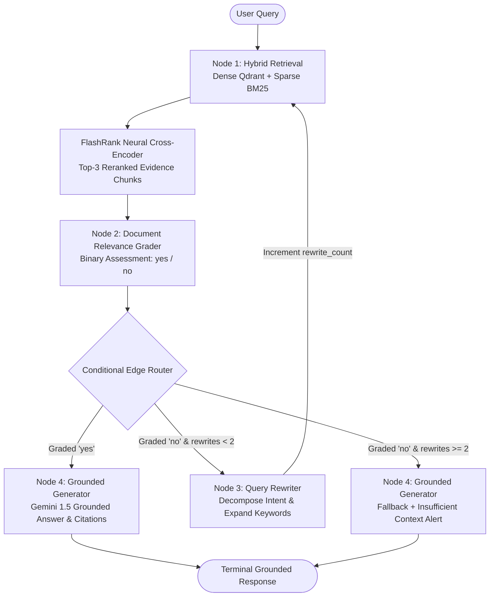

# Enterprise Corrective RAG (CRAG) Engine with Hybrid Search & Reranking

A production-ready Enterprise Corrective Retrieval-Augmented Generation (CRAG) agentic retrieval engine built with **LangGraph**, **FastAPI**, **Qdrant**, **BM25**, and **FlashRank**, featuring an interactive web dashboard and full **VS Code** optimization.

---

## Architecture Diagram



---

## Core Stack

| Component | Technology | Role |
| :--- | :--- | :--- |
| **Agentic Framework** | **LangGraph** (StateGraph) | Orchestrates the self-reflective loop, state transitions, and guardrails |
| **API & Backend** | **FastAPI**, **Uvicorn**, **Pydantic v2** | High-performance async REST API and endpoints |
| **Dense Vector DB** | **Qdrant** (Local Client / In-Memory) | Dense vector storage with cosine similarity search |
| **Sparse Lexical Search** | **BM25Okapi** (`rank_bm25`) | Lexical search for precise keyword and technical term matching |
| **Reranker** | **FlashRank** (`ms-marco-TinyBERT`) | Ultra-lightweight CPU cross-encoder reranker for top-3 candidates |
| **Embeddings & LLM** | **Google Gemini** via `langchain-google-genai` | Gemini 1.5 Flash for grading, query rewriting, and grounded generation |
| **Interactive Web UI** | **HTML5**, **Tailwind CSS**, **Marked.js** | Live interactive CRAG flow visualizer, query runner, and corpus explorer |
| **Evaluation** | **Ragas** | Benchmark faithfulness and answer relevancy metrics harness |

---

## Project Structure

```
rag_engine/
├── app/
│   ├── __init__.py
│   ├── main.py                     # FastAPI entrypoint (/health, /query, /ingest, /ui)
│   ├── config.py                   # Pydantic Settings & environment variables
│   ├── core/
│   │   ├── __init__.py
│   │   ├── state.py                # TypedDict state schema for LangGraph
│   │   ├── graph.py                # Graph assembly (nodes, edges, conditional router)
│   │   └── nodes.py                # Node implementations (retrieve, grade, rewrite, generate)
│   ├── services/
│   │   ├── __init__.py
│   │   ├── ingestion.py            # Recursive & layout-aware chunking pipeline (chunk=600, overlap=100)
│   │   ├── retriever.py            # Hybrid search (Dense Qdrant + BM25) + FlashRank Reranker
│   │   └── llm.py                  # Model definitions & structured output parsers
│   ├── schemas/
│   │   ├── __init__.py
│   │   └── api_models.py           # Request/response schemas with source attribution
│   └── templates/
│       └── index.html              # Interactive Web UI & Live State Machine Visualizer
├── tests/
│   ├── __init__.py
│   ├── test_pipeline.py            # Unit tests for routing and node transitions
│   └── eval_ragas.py               # Ragas evaluation script (faithfulness, recall)
├── sample_docs/                    # 3 sample enterprise technical specification files
│   ├── enterprise_crag_architecture.md
│   ├── distributed_consensus_raft.md
│   └── kubernetes_pod_lifecycle.md
├── requirements.txt
└── README.md                       # Setup, API curl samples, and architecture diagram
```

---

## Getting Started in VS Code

### 1. Open Workspace in VS Code
Open the project folder directly in VS Code:
```bash
code .
```
The workspace includes `.vscode/settings.json` and `.vscode/launch.json` pre-configured for `.venv` auto-activation, pytest test discovery, and 1-click debugging.

### 2. Configure Environment (`.env`)
Copy `.env.example` to `.env` and add your Google Gemini API key:
```bash
GOOGLE_API_KEY=your_gemini_api_key_here
```
*(Note: If no API key is provided, the engine runs in deterministic local fallback mode with local embeddings, allowing complete offline testing and evaluation.)*

### 3. Run the Interactive Web Server
Start the server using Python or the VS Code Run & Debug panel (`F5`):
```bash
python run_server.py
```
Or with Uvicorn:
```bash
uvicorn rag_engine.app.main:app --host 127.0.0.1 --port 8000 --reload
```

- **Interactive Web UI**: [http://127.0.0.1:8000](http://127.0.0.1:8000)
- **Interactive Swagger Docs**: [http://127.0.0.1:8000/docs](http://127.0.0.1:8000/docs)

---

## API Curl Samples

### 1. System Health Check (`GET /health`)
```bash
curl -X GET "http://127.0.0.1:8000/health"
```
**Response:**
```json
{
  "status": "healthy",
  "version": "1.0.0",
  "qdrant_status": "connected (local)",
  "total_documents_indexed": 12,
  "bm25_initialized": true,
  "gemini_configured": true
}
```

### 2. Ingest Document Content (`POST /ingest`)
#### Ingest raw text:
```bash
curl -X POST "http://127.0.0.1:8000/ingest" \
  -H "Content-Type: application/json" \
  -d '{
    "text": "Raft decomposes consensus into Leader Election, Log Replication, and Safety Invariants.",
    "source": "consensus_guide.md"
  }'
```

#### Ingest via file upload (`.txt`, `.md`, `.pdf`):
```bash
curl -X POST "http://127.0.0.1:8000/ingest" \
  -F "file=@sample_docs/enterprise_crag_architecture.md"
```

### 3. Execute CRAG Query (`POST /query`)
```bash
curl -X POST "http://127.0.0.1:8000/query" \
  -H "Content-Type: application/json" \
  -d '{
    "query": "How does the Raft protocol elect a leader and achieve quorum?"
  }'
```
**Response:**
```json
{
  "answer": "Based on the enterprise corpus [distributed_consensus_raft.md, chunk_001]: Raft consensus decomposes leader election, log replication, and safety invariants...",
  "sources": [
    {
      "content": "A Raft cluster typically consists of an odd number of servers...",
      "source": "distributed_consensus_raft.md",
      "chunk_id": "distributed_consensus_raft.md#chunk_001_8a12bc",
      "score": 0.9412,
      "dense_score": 0.8871,
      "sparse_score": 12.45
    }
  ],
  "rewritten_query": null,
  "relevance_score": "yes",
  "rewrite_count": 0,
  "latency_ms": 42.15,
  "route_history": ["retrieve", "grade_documents", "generate"],
  "warning": null
}
```

---

## Running Verification Tests & Benchmarks

Run the complete pytest test suite:
```bash
pytest rag_engine/tests/test_pipeline.py -v
```

Run the Ragas evaluation benchmark:
```bash
python rag_engine/tests/eval_ragas.py
```
